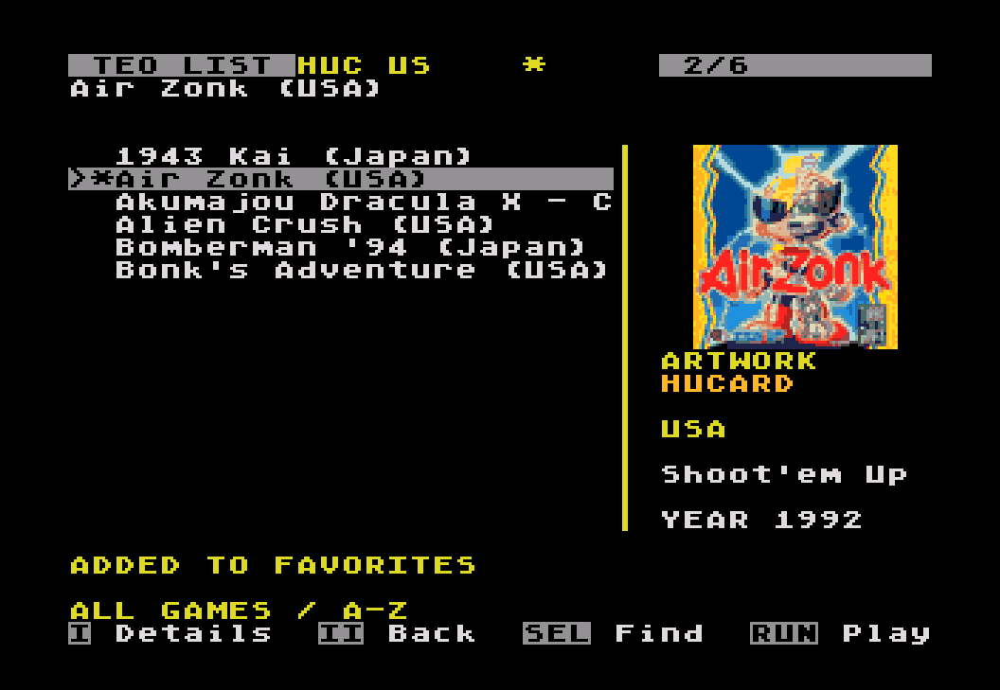
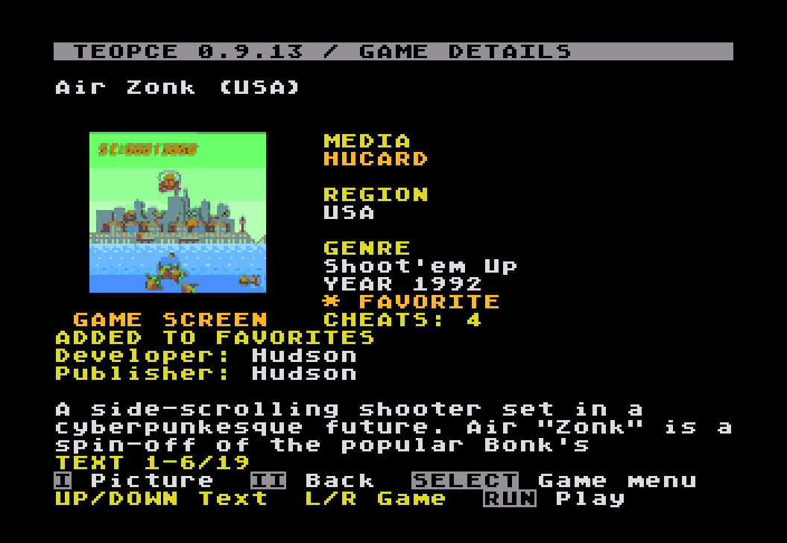
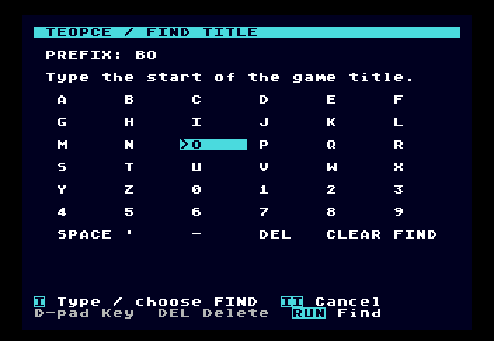

# TeoPCE

**Your PC Engine collection, with a visual menu of its own.**

Pick a cover. Read about the game. Find an old favourite — or something you have never played. TeoPCE brings artwork, game cards, search and per-game cheats to a real **PC Engine / CoreGrafx with Turbo EverDrive Pro**.

The companion **Catalog Manager for Mac and Windows** prepares your own collection. No AI subscription, account or API key is needed.

[**Download RC6**](https://github.com/marvelfamily/TeoPCE/releases/tag/v0.2.0-rc6) · [**Explore the visual tour**](docs/TOUR.md) · [Report an issue](https://github.com/marvelfamily/TeoPCE/issues/new/choose)

[](https://github.com/marvelfamily/TeoPCE/actions/workflows/checks.yml)
[](https://github.com/marvelfamily/TeoPCE/actions/workflows/release.yml)
[](LICENSE)

| Browse by cover | Keep the titles in view |
| --- | --- |
| [](docs/images/console-grid.png) | [](docs/images/console-list.png) |
| Six covers, a highlighted selection and the selected title above. | A readable list, artwork and release facts alongside it. |

*Real TeoPCE 0.9.13 interface, captured from the emulator UI preview with a sample catalog. Lossless PNGs enlarged exactly 3×; click any image for the full file. [Capture details](docs/SCREENSHOTS.md).*

**Read the guide:** [English](docs/USER-GUIDE.md) · [Deutsch](docs/USER-GUIDE-DE.md) · [Français](docs/USER-GUIDE-FR.md) · [Español](docs/USER-GUIDE-ES.md) · [Italiano](docs/USER-GUIDE-IT.md) · [Українська](docs/USER-GUIDE-UK.md)

**Current release candidate:** Catalog Manager **0.2.0-rc6** for Mac and Windows, with console ROM **0.9.15**. This update fixes first launches on freshly prepared cards. Black Hole Assault (Japan) reached combat on a CoreGrafx with all cheats off. [Release checks](RELEASE-STATUS.md)

## Download and start

| Computer | Download | Notes |
| --- | --- | --- |
| Mac with Apple Silicon | [macOS arm64 ZIP](https://github.com/marvelfamily/TeoPCE/releases/download/v0.2.0-rc6/TeoPCE-Manager-0.2.0-rc6-macOS-arm64.zip) | Standalone app; ad-hoc signed, not notarized |
| Windows with x64 application support | [Windows x64 ZIP](https://github.com/marvelfamily/TeoPCE/releases/download/v0.2.0-rc6/TeoPCE-Manager-0.2.0-rc6-Windows-x64.zip) | Windows x64 application, unsigned |
| Developers | [Source ZIP](https://github.com/marvelfamily/TeoPCE/releases/download/v0.2.0-rc6/TeoPCE-Manager-0.2.0-rc6-source.zip) | Python tools, C ROM sources, tests and licensed resources |

[SHA-256 checksums](https://github.com/marvelfamily/TeoPCE/releases/download/v0.2.0-rc6/SHA256SUMS.txt) accompany all archives. Packaged apps need no separate Python. Intel Mac users can run the Python source version.

1. Start with a backed-up SD that already boots your games through the native EverDrive menu. Supply your own games, CD BIOS and firmware.
2. Extract and open the manager. **Choose card…** selects the root containing `edturbo`.
3. **Prepare collection**, then review **Collection** and **Activity**, including skipped games and missing artwork. Preparation happens on your computer.
4. **Install on card**. Wait for **Installed and verified**, then safely eject.
5. Start **TeoPCE.pce** from the EverDrive menu on the console.

The manager installs the ROM **with its matching catalog**. A ROM alone is not a complete setup. First-launch help, editing, updates and recovery are in the [complete guide](docs/USER-GUIDE.md).

### Already using RC4?

Back up your card. Download [the replacement TeoPCE.pce](https://github.com/marvelfamily/TeoPCE/releases/download/v0.2.0-rc6/TeoPCE.pce) and replace the file of the same name at the SD root. Keep your games, `00TEOPCE` and any pending recovery journal. If `edturbo/gamedata` is missing, create that empty directory. Safely eject and open TeoPCE from the EverDrive menu. This update uses your existing catalog. For future library changes use the RC6 manager.

## Made for the two-button controller

**I** opens the game card. **SELECT** brings up search and filters. **RUN** starts the selected game. The footer changes with each screen, so the controls stay close at hand.

| Read before you play | A closer look |
| --- | --- |
| [](docs/images/console-detail.png) | [](docs/images/console-screenshot.png) |
| Covers, year, genre, region, developer/publisher and your descriptions. | Press I to switch between available cover and game screenshot. |

- **Choose your view:** list with artwork or a six-cover grid; longer selected titles wrap above the collection.
- **Find a game:** A–Z order, title-prefix keyboard, first-letter and genre pickers.
- **Combine filters:** media, region/English patch, category, favourites/recent and available cheats.
- **Keep your place:** up to 64 favourites, eight recently opened games, saved view/theme and selection of the latest available history entry on restart.
- **Choose a mood:** Neon, Ember, Ice or the black, yellow and grey Classic theme.
- **Manage codes per game:** read instructions, save selections, see active-code status or turn all codes off at once.

| Narrow the collection | Type the start of a title |
| --- | --- |
| [](docs/images/console-filters.png) | [](docs/images/console-search.png) |

Original releases, translations, homebrew, museum entries, tools/tests and unlicensed releases each have a category. Filters change what you see, without moving the files. [See every option, the results, themes and controls →](docs/TOUR.md)

The target is **PC Engine / CoreGrafx + Turbo EverDrive Pro**. SuperGrafx games are hidden on CoreGrafx. Other EverDrive models and SuperGrafx launching are not supported by this release.

## Prepare on your computer, play on your console

[](docs/images/manager-collection.png)

*Actual macOS manager with a five-game sample collection prepared by the real scanning/matching worker. The 5/5 coverage belongs to this sample; availability varies with your games.*

| Page | What it does |
| --- | --- |
| **Your card** | Select the SD, see what is included or downloaded, choose offline mode and import an additional TeoPCE cheat library |
| **Collection** | Search games, review cover/year/cheat coverage, find missing covers and inspect each game |
| **Game card** | Preview the original artwork and inspect facts and their source |
| **Edit** | Set title, year, category and description; choose a local cover |
| **Cheats** | Inspect the complete groups matched to this release; activate them later on the console |
| **Activity** | Follow actual file checks, matching, downloads, cache use and warnings |

Preparation takes place on your computer. Installation verifies a backup of the existing TeoPCE files, checks for changed state and verifies the installed set. Games and native `edturbo` files stay in place. [Tour all manager pages →](docs/TOUR.md#the-desktop-manager)

## Where the content comes from

| Content | Source |
| --- | --- |
| Games, CD BIOS, firmware | Your own files; never included or downloaded |
| Names, years, developers, publishers | Bundled, pinned Libretro Database snapshot; ambiguous facts are not invented |
| Covers and screenshots | Available images from pinned Libretro Thumbnails sources; downloaded and cached during preparation; custom covers supported |
| Prose descriptions | Your text in Edit, or your prepared reference through the CLI; not automatically downloaded |
| Cheats | Bundled, attributed library matched to exact content; additional TeoPCE JSON libraries can be imported |

The cheat library contains **1,177 complete groups for 347 exact releases: 244 HuCard and 103 CD**. Coverage is not a promise that every effect works throughout every game. Revisions/translations may have no compatible pack. **53 CD bindings also require a specific relative path**, explained by the manager when it differs.

Some CD combinations are intentionally blocked. HELD entries have known issues or unsupported data; only eligible entries offer a risk override. See [cheat use and limits](docs/USER-GUIDE.md#cheats) and [library format](docs/CHEAT-LIBRARY.md).

## Compatibility notes

- Native IGM exits to the EverDrive menu; start TeoPCE again to return to its collection.
- HuCard IGM and quick save/load were exercised on the owner's hardware. In the tested configuration CD games have no native IGM or quick save states.
- Games failing in the native menu need image/BIOS/card diagnosis first. TeoPCE does not repair disc images.
- After adding games, **Prepare / Refresh collection → Install on card**. Renaming, deleting or replacing installed entries may require a separate state migration.
- The native bridge recognizes two Krikzz menu builds. Their CRC32 identifiers are listed in the release checks. See [RELEASE-STATUS.md](RELEASE-STATUS.md) and [VERIFICATION.json](VERIFICATION.json).

## Development

With Python **3.10+**, Tk and Pillow:

```sh
python -m pip install -r requirements.txt
python tools/catalog_manager.py
python -m unittest discover -s tests -v
```

[Development guide](docs/DEVELOPMENT.md): virtual environments, CLI preparation, packaging and optional native ROM builds. [Contributing](CONTRIBUTING.md): focused changes and reproducible bug reports. Please do not upload games, BIOS, saves or card dumps to issues or pull requests.

## Credits and licenses

TeoPCE is an independent community project, not an official Krikzz product.

- TeoPCE code: [MIT](LICENSE).
- Krikzz Turbo EverDrive SDK and cc65: notices in [licenses](licenses).
- Adapted Libretro metadata and cheats: [CC BY-SA 4.0](licenses/LIBRETRO-DATABASE-LICENSE.txt), with retained source files and attribution.
- Downloaded artwork: rights remain with its respective holders; thumbnail availability is not a blanket redistribution license.

Game artwork shown inside documentation screenshots remains the property of its respective rights holders; the screenshots illustrate the interface, not an included artwork pack.

Full provenance, adaptations and runtime notices: [THIRD-PARTY.md](THIRD-PARTY.md).
