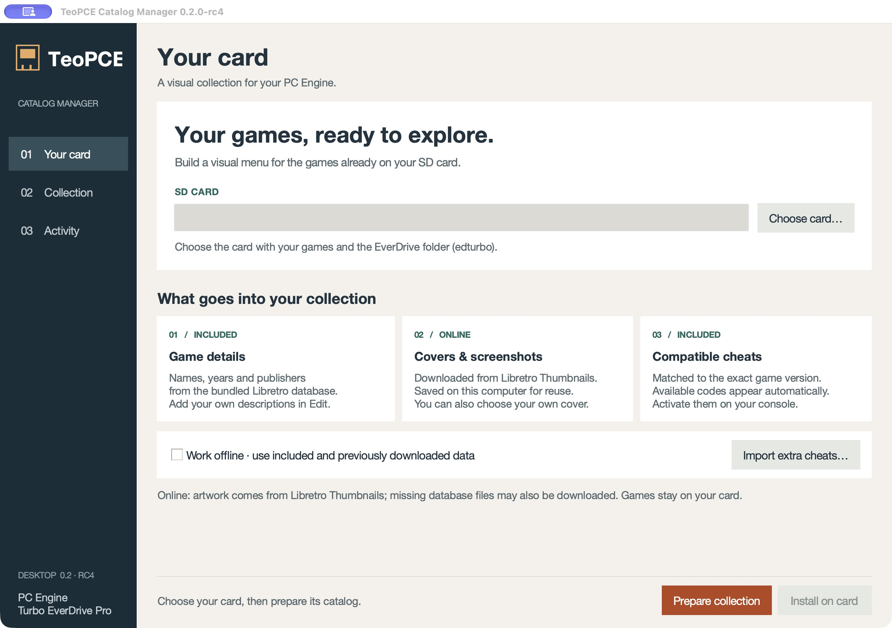

# TeoPCE

**Your PC Engine collection, with a visual menu of its own.**

Browse covers, read game details, find a favourite and choose compatible cheats on a real **PC Engine / CoreGrafx with Turbo EverDrive Pro**. The companion **Catalog Manager for Mac and Windows** builds a catalog from the games already on your SD card.

[Download RC4](https://github.com/marvelfamily/TeoPCE/releases/tag/v0.2.0-rc4) · [English guide](docs/USER-GUIDE.md) · [Инструкция на русском](docs/QUICKSTART-RU.md) · [Report an issue](https://github.com/marvelfamily/TeoPCE/issues/new/choose)



*The packaged macOS manager, on its initial setup screen. Original TeoPCE interface and artwork.*

> **Public preview:** Catalog Manager **0.2.0-rc4**, console ROM **0.9.13**. The console ROM has been used on real hardware; the portable manager is a release candidate. [Verification and remaining checks](RELEASE-STATUS.md).

## Download and start

| Computer | Download | Notes |
| --- | --- | --- |
| Mac with Apple Silicon | [macOS arm64 ZIP](https://github.com/marvelfamily/TeoPCE/releases/download/v0.2.0-rc4/TeoPCE-Manager-0.2.0-rc4-macOS-arm64.zip) | Standalone app; ad-hoc signed, not notarized |
| Windows with x64 application support | [Windows x64 ZIP](https://github.com/marvelfamily/TeoPCE/releases/download/v0.2.0-rc4/TeoPCE-Manager-0.2.0-rc4-Windows-x64.zip) | Tested through x64 emulation on Windows 11 ARM64; unsigned |
| Developers | [Source ZIP](https://github.com/marvelfamily/TeoPCE/releases/download/v0.2.0-rc4/TeoPCE-Manager-0.2.0-rc4-source.zip) | Python tools, C ROM sources, tests and licensed resources |

[SHA-256 checksums](https://github.com/marvelfamily/TeoPCE/releases/download/v0.2.0-rc4/SHA256SUMS.txt) accompany all archives. Packaged apps need no separate Python. Intel Mac has no packaged build in RC4.

1. Start with a backed-up SD that already boots your games through the native EverDrive menu. Supply your own games, CD BIOS and firmware.
2. Extract and open the manager. **Choose card…** selects the root containing `edturbo`.
3. **Prepare collection**, then review **Collection** and **Activity**, including skipped games and missing artwork. Preparation happens on your computer.
4. **Install on card**. Wait for **Installed and verified**, then safely eject.
5. Start **TeoPCE.pce** from the EverDrive menu on the console.

The manager installs the ROM **with its matching catalog**. A ROM alone is not a complete setup. First-launch help, editing, updates and recovery are in the [complete guide](docs/USER-GUIDE.md).

## On your console

- List and cover views, game cards and screenshots where available.
- Search, letter navigation, genre/region/media/category filters.
- Favourites, recent games and themes, including Classic.
- Per-game cheat selection, saved choices and an active-code indication.
- Native EverDrive game launch and save handling.

The target is **PC Engine / CoreGrafx + Turbo EverDrive Pro**. SuperGrafx games are hidden on CoreGrafx. Other EverDrive models and SuperGrafx launching are not supported by this release.

## On your computer

**Your card** explains sources and online/offline preparation. **Collection** shows actual games, cover/year coverage, compatible code counts and a missing-cover filter. **Activity** reports file checks, downloads, cache use and warnings.

Edit titles, years, categories and descriptions; choose your own cover. Installation verifies a backup of the existing TeoPCE files before replacing the application and catalog. Games and native `edturbo` files stay in place.

## Where the content comes from

| Content | Source |
| --- | --- |
| Games, CD BIOS, firmware | Your own files; never included or downloaded |
| Names, years, developers, publishers | Bundled, pinned Libretro Database snapshot; ambiguous facts are not invented |
| Covers and screenshots | Available images from pinned Libretro Thumbnails sources; downloaded and cached during preparation; custom covers supported |
| Prose descriptions | Your text in Edit, or your prepared reference through the CLI; not automatically downloaded |
| Cheats | Bundled, attributed library matched to exact content; additional TeoPCE JSON libraries can be imported |

The cheat library contains **1,177 complete groups for 347 exact releases: 244 HuCard and 103 CD**. Coverage is not a promise that every effect works throughout every game. Revisions/translations may have no compatible pack. **53 CD bindings also require a specific relative path**, explained by the manager when it differs.

Some CD combinations are intentionally blocked. HELD entries have known issues or unsupported data; only eligible entries offer a risk override. See [cheat use and limits](docs/USER-GUIDE.md#cheats) and [library format](docs/CHEAT-LIBRARY.md).

## Compatibility notes

- Native IGM exits to the EverDrive menu; start TeoPCE again to return to its collection.
- HuCard IGM and quick save/load were exercised on the owner's hardware. In the tested configuration CD games have no native IGM or quick save states.
- Games failing in the native menu need image/BIOS/card diagnosis first. TeoPCE does not repair disc images.
- After adding games, **Prepare / Refresh collection → Install on card**. Renaming, deleting or replacing installed entries may require a separate state migration.
- Fresh arbitrary collections still need console validation. See [RELEASE-STATUS.md](RELEASE-STATUS.md) and [VERIFICATION.json](VERIFICATION.json).

## Development

With Python **3.10+**, Tk and Pillow:

```sh
python -m pip install -r requirements.txt
python tools/catalog_manager.py
python -m unittest discover -s tests -v
```

[Development guide](docs/DEVELOPMENT.md): virtual environments, CLI preparation, packaging and optional native ROM builds. [Contributing](CONTRIBUTING.md): focused changes and reproducible bug reports. Please do not upload games, BIOS, saves or card dumps to issues or pull requests.

## Credits and licenses

TeoPCE is an independent community project, not an official Krikzz product.

- TeoPCE code: [MIT](LICENSE).
- Krikzz Turbo EverDrive SDK and cc65: notices in [licenses](licenses).
- Adapted Libretro metadata and cheats: [CC BY-SA 4.0](licenses/LIBRETRO-DATABASE-LICENSE.txt), with retained source files and attribution.
- Downloaded artwork: rights remain with its respective holders; thumbnail availability is not a blanket redistribution license.

Full provenance, adaptations and runtime notices: [THIRD-PARTY.md](THIRD-PARTY.md).
