# A tour of TeoPCE

**From a shelf of covers to the game you want to play.**

TeoPCE runs on PC Engine / CoreGrafx with Turbo EverDrive Pro. Catalog Manager prepares the artwork, details and matching cheat packs on Mac or Windows. This tour follows both halves: choosing a game on the console, then making the collection your own on the computer.

[Project home](../README.md) · [Download RC4](https://github.com/marvelfamily/TeoPCE/releases/tag/v0.2.0-rc4)

**Setup and reference:** [English](USER-GUIDE.md) · [Deutsch](USER-GUIDE-DE.md) · [Français](USER-GUIDE-FR.md) · [Español](USER-GUIDE-ES.md) · [Italiano](USER-GUIDE-IT.md) · [Українська](USER-GUIDE-UK.md)

**Explore:** [Library](#the-library) · [Finding games](#finding-games) · [Categories](#categories-with-a-purpose) · [Game cards](#the-game-card) · [Favourites and history](#favourites-and-history) · [Themes](#four-console-themes) · [Cheats](#cheats-for-the-selected-game) · [Desktop manager](#the-desktop-manager) · [Installation](#from-preparation-to-play) · [Feature reference](#feature-reference)

Console images are real emulator captures of the 0.9.13 UI preview with a six-game personal sample catalog. Desktop images show the RC4 interface and a separate five-game prepared sample. They illustrate the interface, not proof that a game or code was tested on hardware. Console frames are lossless PNG; desktop captures are published as PNG without resizing. Click to view full resolution. [How these images were made](SCREENSHOTS.md).

## The library

### Six covers at a time

The grid gives each game its own cover. A visible selection frame follows the D-pad. Tile captions are compact; the selected title is also shown in the header, with wrapping for longer names. The current position tells you where you are in the filtered collection.

### Titles and artwork together

[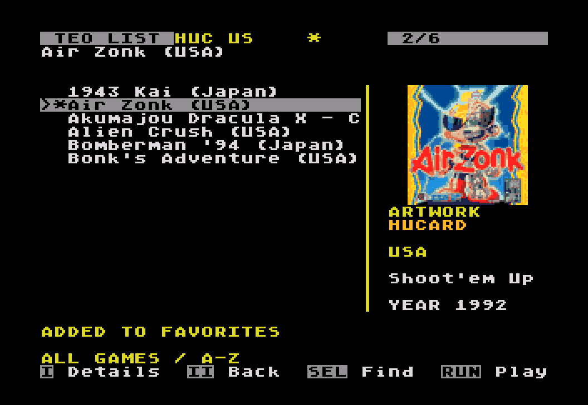](images/console-list.png)

The list is useful when you know the name you are looking for. The side panel shows the selected game's artwork, media, region, genre and year when available. The yellow confirmation here follows a real **Add to favorites** action.

**I** opens details. **SELECT** opens find/filters. **RUN** starts the selected game through the native EverDrive path. Hold a direction to scroll; use left/right to page in the list. In a filtered collection, **II** returns to all games.

## Finding games

The ordinary collection is ordered **A–Z**. You can narrow it with several filters at once; the result stays in alphabetical order unless you choose **Recently opened**, which follows history order. Year and publisher are descriptive fields, not sort modes in this release.

### Search from the controller

| Enter a prefix | See the matching games |
| --- | --- |
| [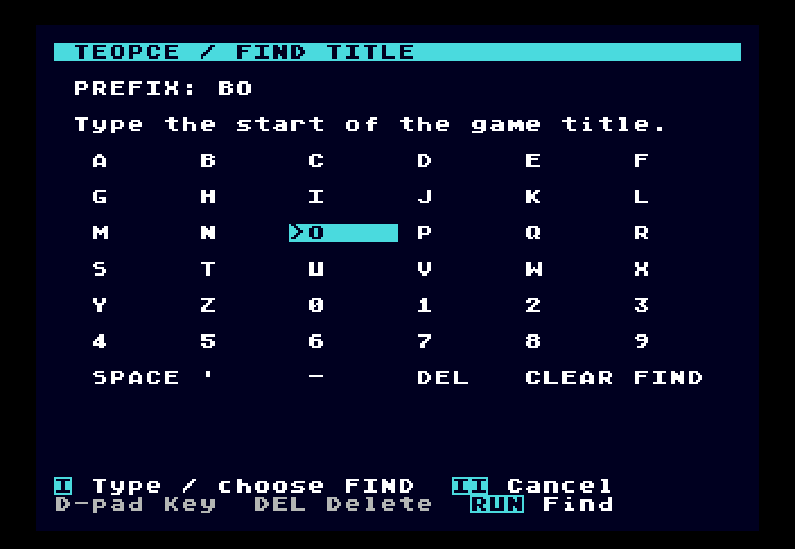](images/console-search.png) | [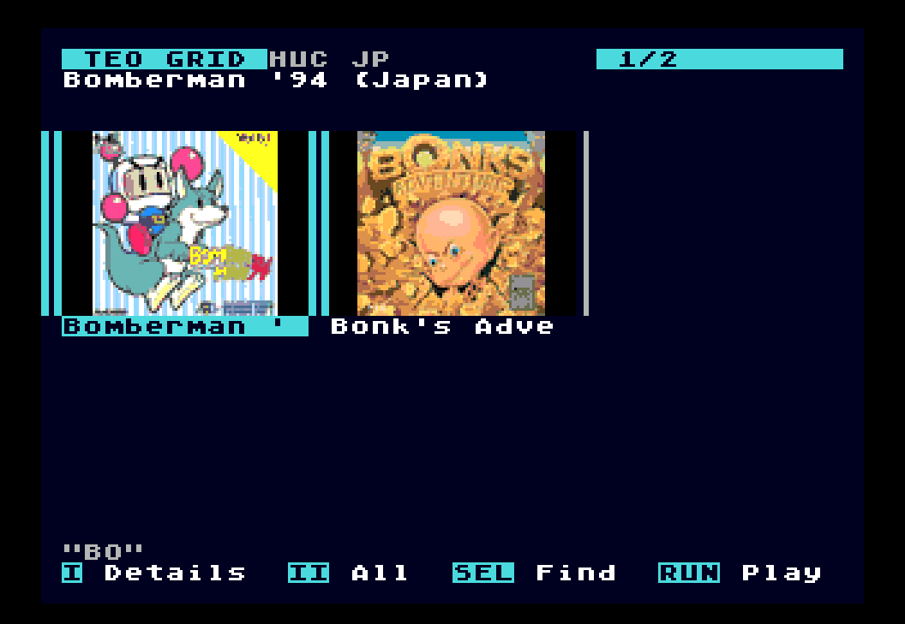](images/console-results.png) |

Choose **TITLE PREFIX** and type the beginning of the name. The keyboard supports letters, digits, spaces, apostrophes and hyphens; **DEL** removes a character, **CLEAR** starts over and **RUN / FIND** applies the search. Prefixes can be up to 12 characters. In this example, `BO` finds Bomberman and Bonk.

### Jump by letter or choose a genre

| First letter | Genre picker |
| --- | --- |
| [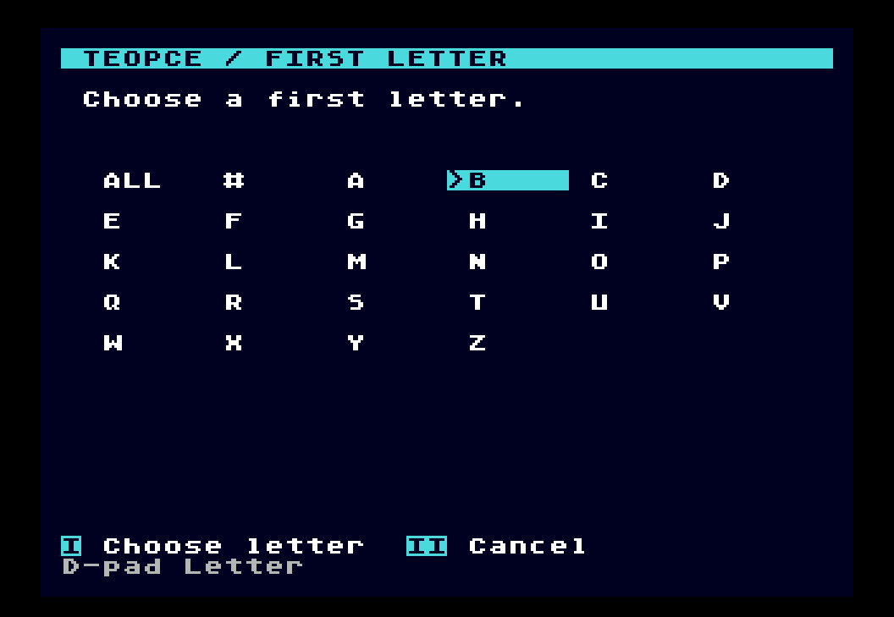](images/console-letter.png) | [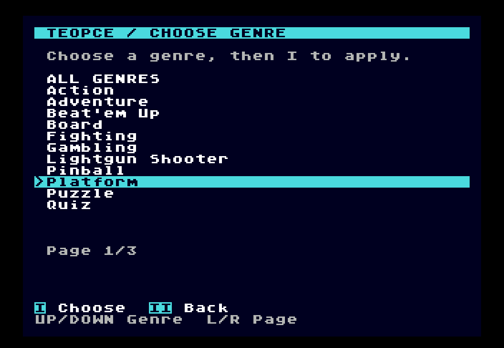](images/console-genres.png) |

The letter picker offers **A–Z**, **#** for titles beginning with a number or symbol, and **ALL**. The genre picker uses a readable paged list: Action, Adventure, Beat'em Up, Pinball, Platform, Puzzle, RPG, Shoot'em Up and more. Up/down selects; left/right pages; **I** applies.

### Combine the options

[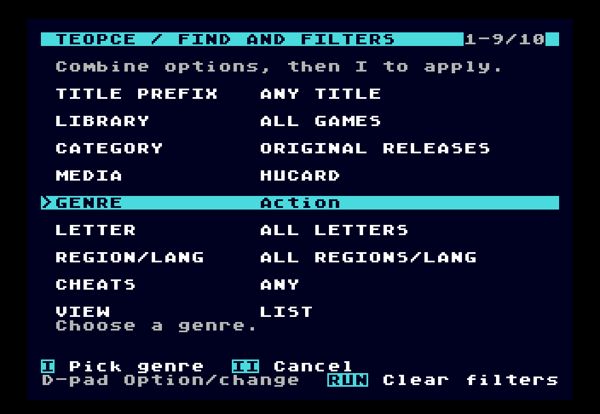](images/console-filters.png)

For an action-game evening, choose **Original releases + HuCard + Action**. To revisit something, switch **LIBRARY** to **FAVORITES** or **RECENTLY OPENED**. Add a region or title prefix when the result is still too broad.

| Filter | Choices |
| --- | --- |
| **Title prefix** | Beginning of the title, up to 12 characters |
| **Library** | All games, favourites, recently opened |
| **Category** | Original releases, translations, homebrew, museum, tools/tests, unlicensed |
| **Media** | HuCard, CD-ROM, all |
| **Genre** | A paged list of supported catalog genres |
| **Letter** | A–Z, #, all |
| **Region/lang** | Japan, USA, English patch, other, all |
| **Cheats** | Any game, or games with selectable codes |

**VIEW** and **THEME** live on the same page. Change options with left/right, then **I** to apply; **II** cancels. **RUN** clears filter choices. The small position indicator shows that the options continue below the first page.

Short labels in the collection keep the current query visible: `HUC` / `CD` for media, `FAV` for favourites, `OPEN` for recently opened, `B*` for first letter B, `R:JP` / `R:US` for regions and `L:EN` for English patches. `CH` indicates the available-cheats filter. These are reminders of your selection, not extra buttons.

## Categories with a purpose

[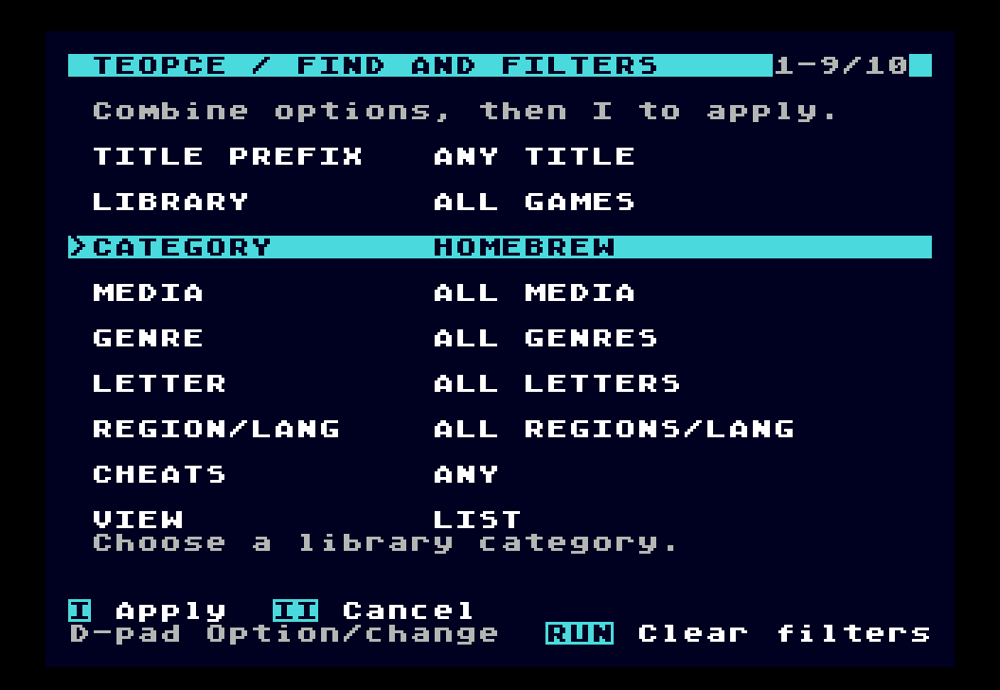](images/console-categories.png)

A collection can contain much more than original commercial releases. Categories keep those different kinds of entries easy to reach, without requiring a different folder layout for browsing.

| Category | Intended use |
| --- | --- |
| **Original releases** | Original commercial game releases |
| **Translations** | Language-patched releases |
| **Homebrew** | Independently created games and software |
| **Museum** | Entries kept for historical interest |
| **Tools / Tests** | Utilities and test programs, such as a display test suite |
| **Unlicensed** | Releases classified as unlicensed |

These are catalog labels, not an automatic historical or legal judgment. The manager can assign a category; **Edit** lets you correct it. The screenshot shows the Homebrew option selected, not a claim that the six-game sample contains homebrew.

## The game card

| Cover and release details | The game in motion, as a still |
| --- | --- |
| [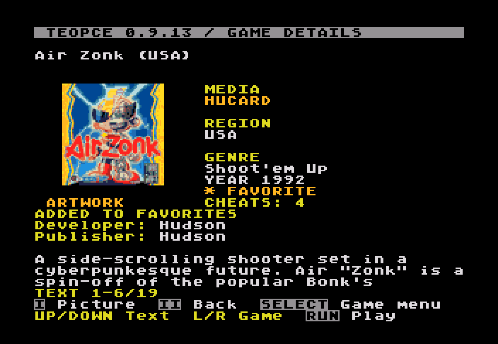](images/console-detail.png) | [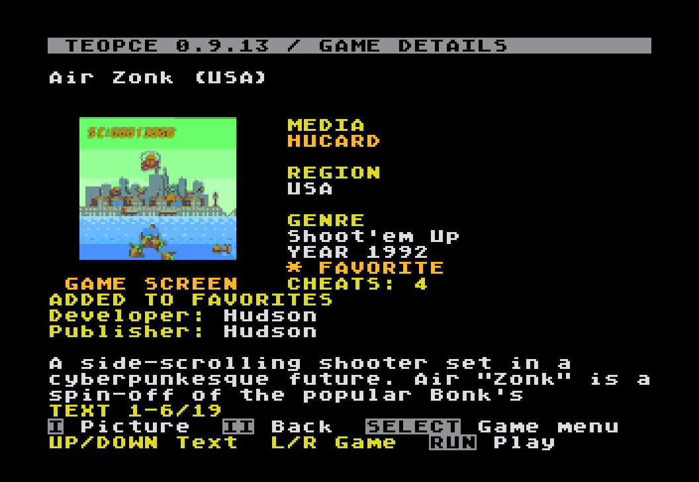](images/console-screenshot.png) |

Press **I** from the library to open the selected game. The card brings together media, region, genre, year, favourite status, available cheat information and the text in your catalog. Developer and publisher facts appear with the description when available.

- **I — Picture:** switch between the cover and available game screenshot.
- **Up/down — Text:** scroll the description; the line counter shows your place.
- **Left/right — Game:** move to the previous or next game without returning to the list.
- **SELECT — Game menu:** start, add/remove favourite, open cheats, inspect file information or return to EverDrive.
- **RUN — Play:** launch the selected game.
- **II — Back:** return to the collection.

If cover art is unavailable but a game screenshot exists, the menu can show that instead. Facts and images depend on the specific release. Descriptions in this console sample were supplied with its catalog; the public manager does **not** download prose descriptions automatically.

## Favourites and history

| A smaller personal shelf | Recently opened |
| --- | --- |
| [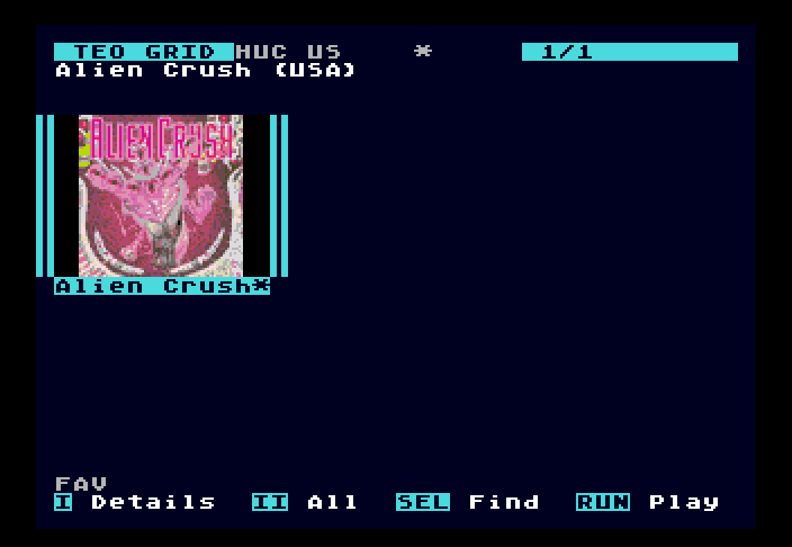](images/console-favorites.png) | [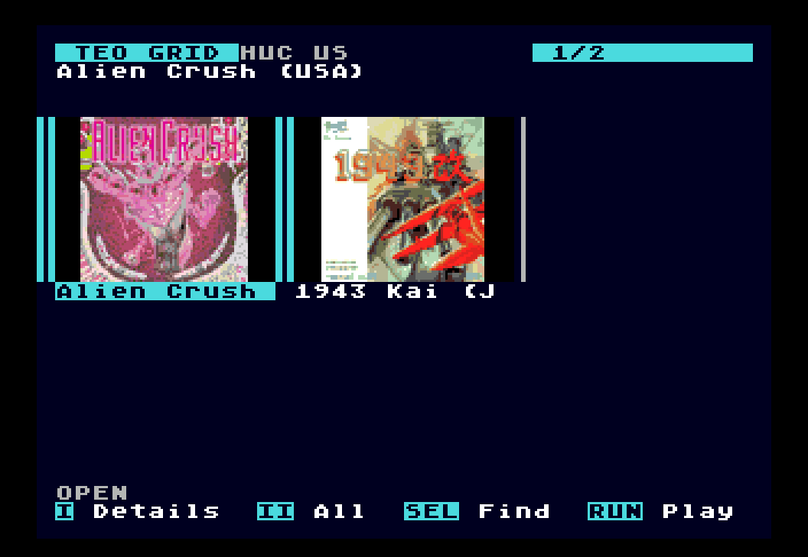](images/console-recent.png) |

Add a game through **Details → SELECT → Add to favorites**. Up to **64 favourites** are stored. A star identifies a favourite; removing it uses the same menu.

**Recently opened** keeps up to **eight entries**. Opening a game card records it, so this is browsing history, not playtime tracking. At startup, TeoPCE selects the latest available history entry in the unfiltered library. Your chosen view and theme are retained too.

The screenshots show actual favourite/history actions within the preview session; persistent SD writes are a native-cartridge feature.

## Four console themes

| Neon | Classic |
| --- | --- |
|  |  |
| Bright cyan accents and a dark background. | Black, yellow and grey, with a restrained selection bar. |

| Ember | Ice |
| --- | --- |
| [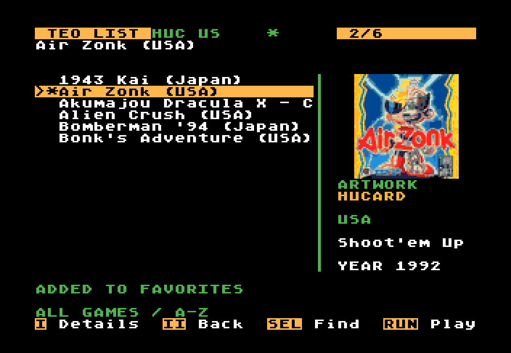](images/console-ember.png) | [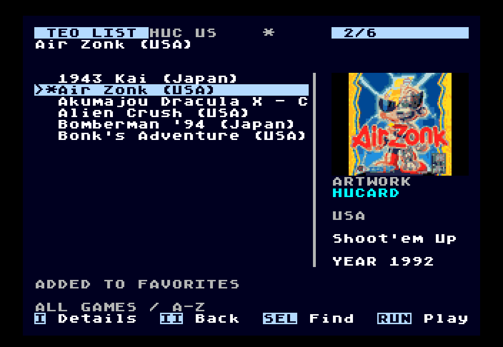](images/console-ice.png) |
| Warm accents across the same controls. | A cooler palette for the same layout. |

[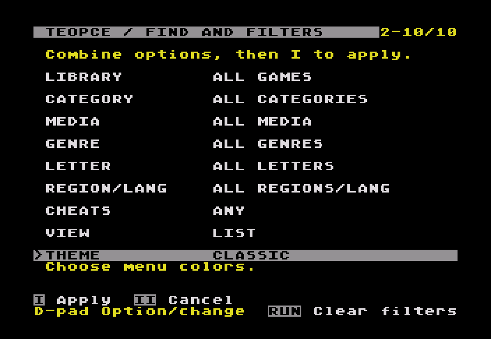](images/console-themes.png)

Open **SELECT → THEME**, choose with left/right and apply with **I**. Theme changes preserve the same layout and controls; button hints remain visually separate from their actions.

## Cheats for the selected game

[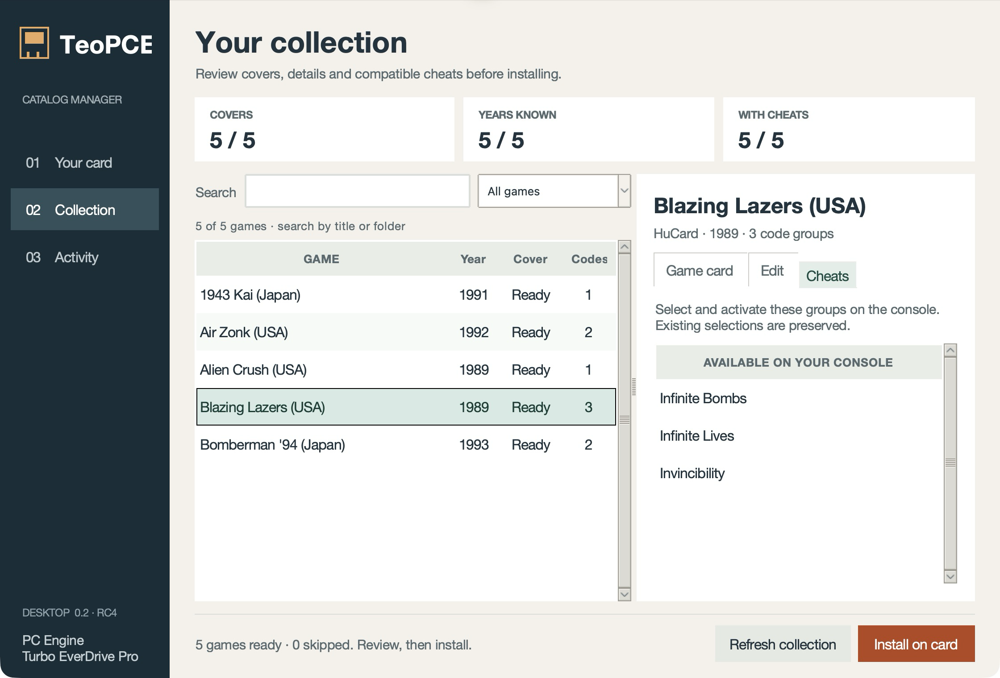](images/manager-cheats.png)

The manager finds a compatible pack and lets you inspect its groups. **Selection and activation happen on the console**, where the saved choices belong to each game:

1. Open the game with **I**, then **SELECT → CHEATS**.
2. Highlight a group and press **I**. Read any game-specific instructions.
3. Use **RUN** to save and return, then start the game.
4. To disable everything, choose **SELECT → All cheats off**. This saves the all-off state immediately and confirms the action.

**II** cancels unsaved selection changes. Saved codes persist, and the library/card indicates active saved codes so that they are not forgotten. Availability and activation are separate: a game can have a cheat pack with every code switched off.

The included library contains **1,177 complete groups for 347 exact releases: 244 HuCard and 103 CD**. These are release matches, not a claim of 347 different game titles or universal cheat compatibility. A group may include several writes, and remains intact when selected.

| Detail | Why it matters |
| --- | --- |
| **Exact matching** | HuCard uses the complete file hash; CD includes the exact CUE bytes and every referenced track, including audio |
| **Path-bound CD entries** | 53 bindings also require a specific relative path; the manager explains a path mismatch |
| **16-slot limit** | One group can consume several slots; reduce the selection when the cartridge budget is exceeded |
| **Combination restrictions** | Some CD startup protections cannot safely be combined, so those selections are blocked |
| **Instructions** | A code may depend on a title-screen action, mode, character or other condition |
| **HELD** | Known issues or unsupported data; hidden by default, with explanations under Show held codes |
| **Accept risk** | Offered only for eligible held entries; malformed/unsupported data cannot be unlocked, and combination checks still apply |

Hiding HELD codes does not disable any that are active. **All cheats off** is the explicit way to clear the selection. A code that boots successfully can still have limits later in the game; report the exact release, group and stage when this happens.

The read-only emulator preview cannot show the cartridge's saved-cheat state reliably, so this gallery uses the real manager's matched-group page for the cheat illustration. It does not substitute a fabricated native activation screen. [Full cheat instructions](USER-GUIDE.md#cheats) · [Import format and attribution](CHEAT-LIBRARY.md).

## The desktop manager

### Your card: know what will happen

[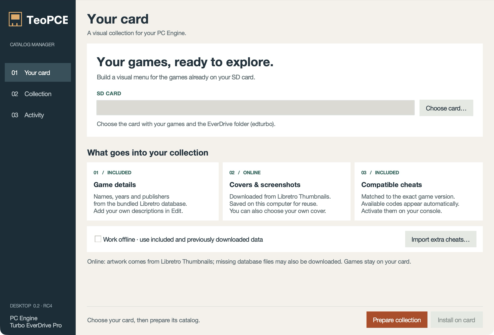](images/catalog-manager.png)

Choose the SD root containing `edturbo`. **Prepare collection** reads your own game files, checks CD references, matches facts and cheat packs, and fetches available artwork. The page separates included data from online downloads and offers **Work offline** and **Import extra cheats…**.

The packaged Mac and Windows apps include their Python runtime. Users do not need a development environment, AI service or subscription to prepare a collection. The application interface is currently English; the six guides explain the same controls in their respective languages.

### Collection: review before installing

Coverage counters show **covers**, **known years** and **games with cheats** for the prepared collection. Search by title or folder; switch to **Missing covers** to find entries needing attention. The game list shows year, cover status and compatible group count.

The **Game card** tab previews the original image and its source information. Console artwork is converted for the PC Engine's display constraints, so the desktop original and console version naturally differ in resolution and colour.

This five-game example has covers, years and packs for all five games. A different collection may have missing data; the interface reports that instead of inventing it.

### Edit: make the card your own

[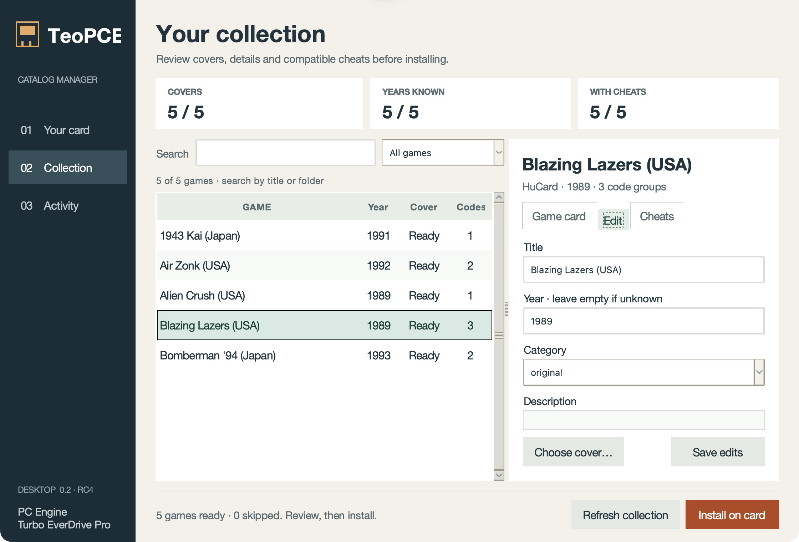](images/manager-edit.png)

Change title, year, category and description. **Choose cover…** accepts a local PNG/JPG/JPEG. The year is populated in this example; the instruction beneath it explains that an unavailable year can be left empty. The description field is a place for your own text, not an unfinished online download.

Use **Save edits → Refresh collection**, review the result and install. The manager prevents installation from an outdated prepared result after edits. Keep the chosen local cover available until preparation finishes. Console text uses a limited character set, so concise English text is recommended for game descriptions.

### Cheats: see what matched

The **Cheats** tab above shows complete matched groups, such as Infinite Bombs, Infinite Lives and Invincibility for this Blazing Lazers release. It previews availability; it does not switch the codes on remotely.

Additional imports must use the documented **version-1 TeoPCE JSON library format**. Existing installed packs/selections retain priority during updates; explicit imported content matches take priority over the bundled library when there is no preserved installed pack.

### Activity: follow the actual work

[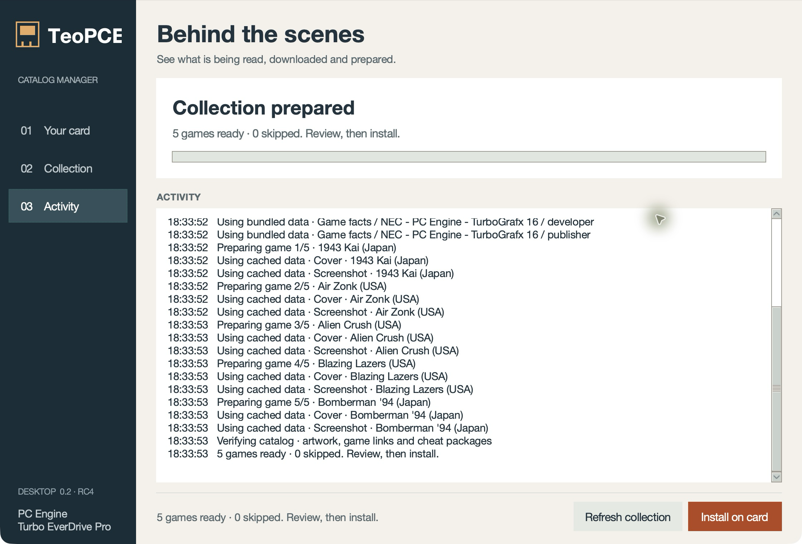](images/manager-activity.png)

Watch scanning, file hashing, metadata/cheat matching, artwork downloads, cache hits and verification. Large CD collections take time because the tracks are read. **View skipped games & warnings** explains items needing attention before installation.

| Content | Source and behaviour |
| --- | --- |
| Games, CD BIOS, EverDrive firmware | Your own files; never included or downloaded |
| Names, years, developers, publishers | Included pinned Libretro Database snapshot; ambiguous facts are omitted |
| Covers and screenshots | Available Libretro Thumbnails images, fetched during preparation and cached; custom covers supported |
| Descriptions | Your text from Edit, or an owned prepared reference through the CLI |
| Cheats | Included attributed library, exact matching and optional TeoPCE JSON import |
| Offline preparation | Uses bundled data, cached images and local artwork; uncached images remain unavailable |

Game files stay local and are not uploaded. An artwork request tells the serving host which image/title is requested. Provenance and license records accompany the generated catalog.

## From preparation to play

**Choose card → Prepare → Review → Install → Safely eject → TeoPCE.pce**

Preparation builds a separate package on the computer. Installation is a distinct action: it checks for changed games/application state, verifies a backup of the previous TeoPCE files, stages the replacement and verifies the installed set. Detected failures attempt rollback; the card must stay connected throughout.

The SD gets one launch file, **TeoPCE.pce**, and one data directory, **00TEOPCE**. Games and native **edturbo** files remain where they are. The automatic backup covers the TeoPCE application/data, not the entire card: keep a separate backup of your games and native saves.

On the console, launch **TeoPCE.pce** from the normal EverDrive menu. TeoPCE uses the native launch path. HuCard IGM and quick save/load were exercised on the owner's hardware; IGM exits to the EverDrive menu, from which TeoPCE can be started again. In the tested CD configuration there is no native IGM or quick save state; normal CD game/BIOS saving is separate.

After adding games, **Refresh collection → review → Install on card**. Existing valid profiles are preserved. Renaming, deleting or replacing existing entries may require a deliberate migration; the manager does not silently discard state to force an update.

## Feature reference

| Area | Included in this release |
| --- | --- |
| Library | List, six-cover grid, wrapped selected title, paging, held-direction scrolling |
| Discovery | A–Z order, title-prefix keyboard, first-letter and paged genre pickers, combined filters |
| Classification | Media, genre, region/English patch, six categories, selectable-cheat filter |
| Game cards | Cover/screenshot toggle, available release facts, scrollable description, adjacent-game navigation |
| Personalisation | 64 favourites, eight recently opened entries, startup selection from history, saved view/theme |
| Themes | Neon, Ember, Ice, Classic |
| Game actions | Launch, favourite, cheats, file information, return to EverDrive |
| Cheat use | Whole groups, instructions, saved per-game choices, active-code indication, immediate all-off, HELD visibility and eligible override |
| Cheat checks | Exact release matching, slot budget, CD path requirements and combination restrictions |
| Desktop review | Collection search, missing-cover filter, coverage counters, game card/editor/cheat tabs, source information |
| Desktop content | Bundled facts/cheats, online artwork/cache, offline mode, custom cover, JSON cheat-library import |
| Installation | Separate preparation, stale-state checks, verified application backup, staged install, verification and rollback attempt |
| Development | MIT program code, source, tests, CLI tools, Mac/Windows build workflows and retained third-party notices |

**Current limits:** PC Engine/CoreGrafx with Turbo EverDrive Pro only; no supported SuperGrafx launch, other cartridge models, automatic disc repair, year/publisher sorting, playtime tracking or CD in-game overlay. Source files and optional tools are documented in the [development guide](DEVELOPMENT.md).

RC4 remains a public preview. The [verification page](../RELEASE-STATUS.md) separates automated checks, packaged startup checks, owner's hardware results and remaining manual tests. For a report, include versions, exact steps, title/revision, error text and whether the same game starts through Krikzz's menu. Please do not upload games, BIOS or saves.

[Download TeoPCE](https://github.com/marvelfamily/TeoPCE/releases/tag/v0.2.0-rc4) · [Read the guide](USER-GUIDE.md) · [Help improve it](../CONTRIBUTING.md)
