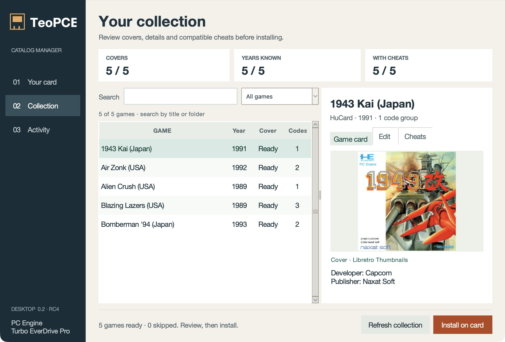

# Guida utente di TeoPCE

[Pagina del progetto](../README.md) · [Tour visuale](TOUR.md)

**Guide:** [English](USER-GUIDE.md) · [Deutsch](USER-GUIDE-DE.md) · [Français](USER-GUIDE-FR.md) · [Español](USER-GUIDE-ES.md) · Italiano · [Українська](USER-GUIDE-UK.md)

L'interfaccia dell'applicazione è attualmente in inglese. Queste istruzioni sono tradotte; i nomi dei pulsanti corrispondono a quelli dell'applicazione.

Per **Catalog Manager 0.2.0-rc6** e **TeoPCE 0.9.15**. Crea il tuo catalogo con i tuoi giochi: non servono la collezione dell'autore, un abbonamento IA o una chiave API.


*Anteprima dell’interfaccia della console in un emulatore; raccolta di esempio sul computer. [Provenienza delle schermate](SCREENSHOTS.md).*

## Prima di iniziare

Usa una **PC Engine / CoreGrafx con Turbo EverDrive Pro**, una SD già funzionante nel menu nativo di EverDrive e una tua BIOS CD funzionante per i giochi CD. Segui le istruzioni di Krikzz per cartuccia, menu e firmware; TeoPCE non installa né aggiorna il firmware.

Esegui un backup della SD, in particolare dei salvataggi di `edturbo` e dello stato esistente in `00TEOPCE/user`. Il backup automatico del gestore copre **TeoPCE.pce e 00TEOPCE**, non l'intera scheda. Mantieni il file system funzionante: l'installazione di TeoPCE non richiede la formattazione.

Spegni la console prima di rimuovere la scheda. Usa un lettore di schede per computer; non serve il debug USB della cartuccia.

## Scaricare e aprire

Scarica lo ZIP per la tua piattaforma dalla [release RC6](https://github.com/marvelfamily/TeoPCE/releases/tag/v0.2.0-rc6) ed estrailo completamente. L'archivio dei sorgenti generato automaticamente da GitHub è destinato allo sviluppo e non è un'applicazione autonoma.

Se hai già installato RC4, fai una copia di sicurezza della scheda e sostituisci il file `TeoPCE.pce` nella directory principale con [la nuova versione](https://github.com/marvelfamily/TeoPCE/releases/download/v0.2.0-rc6/TeoPCE.pce). Conserva `00TEOPCE`, i giochi e ogni eventuale registro di ripristino. Se manca la cartella `edturbo/gamedata`, creala e lasciala vuota. Espelli la scheda in modo sicuro e avvia TeoPCE. Per il prossimo aggiornamento del catalogo usa il gestore RC6.

**Mac:** apri `TeoPCE Catalog Manager.app`. Il download è per Apple Silicon, firmato ad hoc e non autenticato da Apple tramite notarizzazione. Se il primo avvio viene bloccato, controlla download e checksum, quindi usa **System Settings → Privacy & Security → Open Anyway** di macOS, se disponibile. Non disattivare Gatekeeper globalmente. Non è disponibile una versione confezionata per Mac Intel.

**Windows:** esegui `TeoPCE Catalog Manager.exe` dopo averlo estratto, non la copia visualizzata dentro lo ZIP. Non è firmato, quindi Windows può mostrare un avviso di app non riconosciuta. Esamina il codice sorgente e il checksum prima di decidere se eseguirlo. RC4 è stata testata tramite emulazione x64 su Windows 11 ARM64; anche una compilazione successiva ospitata su GitHub ha superato la verifica di avvio. Una prova manuale completa del binario distribuito su Windows Intel/AMD nativo è ancora in sospeso.

Le applicazioni confezionate non richiedono un'installazione separata di Python. Per verificare uno ZIP, confronta il suo digest completo con `SHA256SUMS.txt` della stessa release:

```sh
# macOS Terminal
shasum -a 256 TeoPCE-Manager-0.2.0-rc6-macOS-arm64.zip
```

```powershell
# Windows PowerShell
Get-FileHash .\TeoPCE-Manager-0.2.0-rc6-Windows-x64.zip -Algorithm SHA256
```

## Selezionare e preparare

In **Your card**, usa **Choose card…** e seleziona la **radice della SD che contiene edturbo**, non la cartella `edturbo` stessa. Se una scheda è stata rilevata automaticamente, controlla il percorso visualizzato.

Fai clic su **Prepare collection**. Il gestore cerca i giochi, calcola gli hash del contenuto, verifica i riferimenti alle tracce CD, associa metadati e trucchi e scarica le immagini disponibili. Le grandi collezioni CD richiedono tempo perché vengono lette tutte le tracce. **Activity** mostra le operazioni effettive; lascia la scheda collegata.

La preparazione crea un pacchetto separato sul computer e non installa nulla sulla SD. Prima dell'installazione controlla **View skipped games & warnings**.

### Struttura dei file e formati

I giochi possono rimanere nelle loro cartelle. È un esempio, non uno schema di nomi obbligatorio:

```text
SD root/
├── edturbo/               native EverDrive data, BIOS and saves
├── HuCard/Example.pce
├── CD/Example/
│   ├── Example.cue
│   ├── Track 01.bin
│   └── Track 02.bin
├── TeoPCE.pce             added by installation
└── 00TEOPCE/              added by installation
    ├── data/              catalog, images, details and attribution
    ├── cheats/            per-game packs
    └── user/              settings and cheat selections
```

- Usa `.pce` oppure `.cue` con **tutte** le tracce richiamate; i nomi e le maiuscole devono corrispondere al CUE.
- ZIP, 7z, CHD, CCD e M3U non sono input diretti. Prima estrai o converti i tuoi supporti.
- `MODE1/2048` richiede una conversione in settori raw verificata separatamente. Il gestore la segnala senza riscrivere il disco.
- I percorsi relativi dei giochi devono contenere ASCII stampabile ed essere più corti di 128 byte. Sono supportati al massimo 1.200 candidati per il catalogo.
- I file SuperGrafx possono essere riconosciuti, ma sono nascosti su CoreGrafx; il loro avvio non è supportato in questa release.
- Revisioni HuCard diverse con lo stesso nome base possono entrare in conflitto nell'archiviazione nativa dei salvataggi; i conflitti segnalati richiedono una ridenominazione consapevole.
- Le cartelle nascoste o con prefisso underscore, `edturbo` e `00TEOPCE` sono escluse dalla normale scansione dei giochi.

## Controllare e modificare



**Collection** offre ricerca, conteggi di copertura e **Missing covers**. `Cmd+F` / `Ctrl+F` porta il focus sulla ricerca; `Esc` la cancella. Seleziona un gioco per consultare **Game card**, **Edit** o **Cheats**.

In Edit modifica titolo, anno, categoria e descrizione, oppure usa **Choose cover…** (PNG/JPG/JPEG). Mantieni disponibile l'immagine scelta per la preparazione. Se l'anno non è noto, lascialo vuoto. Usa testo conciso in inglese: il set limitato di caratteri della console normalizza quelli non ASCII e potrebbe eliminarli.

Fai clic su **Save edits → Refresh collection**, controlla di nuovo e poi installa. Una modifica da sola non aggiorna la scheda; l'installazione resta disabilitata finché il risultato preparato non è aggiornato.

### Che cosa usa la connessione?

| Contenuto | Funzionamento |
| --- | --- |
| Dati e trucchi | Snapshot inclusi e fissati; non serve un account |
| Copertine e schermate | Le immagini disponibili di Libretro Thumbnails vengono scaricate e conservate nella cache locale |
| Descrizioni in prosa | Inserite in Edit oppure ricavate tramite CLI da un riferimento preparato di tua proprietà |
| Immagini mancanti | Segnalate chiaramente; puoi aggiungere una tua copertina |
| Lavoro offline | Solo dati inclusi, cache e immagini locali; le immagini non disponibili restano mancanti |

La copertura non è completa per tutte le edizioni. I dati non vengono inventati. I giochi sono letti localmente e non vengono caricati; le richieste delle immagini identificano il titolo richiesto presso il server che le fornisce. Consulta il registro delle attività e il report per informazioni sulle fonti e sulle immagini mancanti.

## Installare e avviare

Scegli **Install on card**, conferma la richiesta e tieni collegata la SD fino a **Installed and verified**. L'installatore controlla se giochi o stato dell'applicazione sono cambiati, verifica un backup sul computer, prepara la nuova applicazione e verifica l'insieme installato. Se rileva errori tenta il ripristino; uno scollegamento o un'interruzione di corrente richiedono comunque di controllare la scheda e il backup.

Espelli la scheda in sicurezza dal sistema operativo, inseriscila nella console spenta, avvia il menu EverDrive e lancia **TeoPCE.pce** dalla radice. La ROM e `00TEOPCE` devono provenire dalla stessa generazione preparata. Non mescolare singoli file del catalogo e non usare il catalogo generato da un'altra persona.

## Controlli della console

Il piè di pagina mostra i controlli della schermata corrente.

| Schermata | Controlli |
| --- | --- |
| Elenco giochi | Croce direzionale: selezione/pagina; **I** dettagli; **SELECT** ricerca/filtri; **RUN** gioca |
| Dettagli | **I** immagine; **II** indietro; **SELECT** menu del gioco; **RUN** gioca; su/giù testo; sinistra/destra gioco |
| Menu del gioco | Avvio, preferito, trucchi, informazioni sul file, ritorno a EverDrive |
| Trucchi | **I** attiva/disattiva e istruzioni; **SELECT** opzioni; **II** annulla; sinistra/destra pagina; **RUN** salva e torna |

### Navigazione, ricerca e filtri

Premi **SELECT** nella libreria per aprire **FIND AND FILTERS**. Su/giù seleziona un'opzione; sinistra/destra la cambia. **I** applica le impostazioni oppure apre il selettore di titolo, genere o lettera nelle rispettive righe. **II** annulla. **RUN** cancella le scelte dei filtri; applicale per tornare a tutti i giochi.

| Opzione | Scelte disponibili |
| --- | --- |
| Title prefix | Digita l'inizio di un titolo con la tastiera su schermo, fino a 12 caratteri; RUN avvia la ricerca |
| Library | Tutti i giochi, preferiti, aperti di recente |
| Category | Uscite originali, traduzioni, homebrew, museo, strumenti/test, senza licenza o tutte le categorie |
| Media | HuCard, CD-ROM o entrambi |
| Genre | Seleziona da un elenco a pagine, per esempio Action, Adventure, Platform, Puzzle, RPG o Shoot'em Up |
| Letter | A–Z, titoli che iniziano con numeri o simboli tramite `#`, oppure tutte le lettere |
| Region/lang | Giappone, USA, patch inglese, altro o tutte |
| Cheats | Qualsiasi gioco oppure giochi con trucchi selezionabili |
| View | Elenco con immagini oppure griglia di sei copertine |
| Theme | Neon, Ember, Ice, Classic |

I filtri si combinano. Per esempio, scegli **Original releases + HuCard + Action**. La libreria ordinaria è in ordine A–Z; Recently opened segue l'ordine della cronologia. In questa versione non esiste l'ordinamento per anno o editore. I filtri cambiano solo l'elenco visualizzato e non spostano i file. **II** in una libreria filtrata cancella i filtri.

Il titolo selezionato appare sopra l'elenco o la griglia, andando a capo se lungo. I dettagli mostrano supporto, regione, genere, anno quando noto e le informazioni disponibili su descrizione, sviluppatore ed editore. **I** alterna copertina e schermata del gioco, quando disponibili; su/giù scorre il testo e sinistra/destra passa da un gioco all'altro.

Aggiungi o rimuovi un preferito tramite **Details → SELECT → Add/Remove favorite**. Sono conservati fino a 64 preferiti e otto giochi aperti di recente. La cronologia registra le schede dei giochi aperte, non il tempo di gioco. Al riavvio TeoPCE seleziona la voce disponibile più recente della cronologia nella libreria senza filtri. Vengono salvate anche le preferenze di vista e tema.

Le etichette brevi descrivono il filtro corrente: `FAV` preferiti, `OPEN` recenti, `B*` titoli che iniziano per B, `R:JP` Giappone, `R:US` USA, `L:EN` patch inglese e `CH` trucchi selezionabili. L'area del titolo indica anche supporto e regione del gioco selezionato; `*` indica un preferito.

**Details → SELECT** apre anche le azioni del gioco: avvio, preferiti, trucchi, informazioni sul file e ritorno a EverDrive. Le informazioni sul file aiutano a identificare la voce e il percorso selezionati nel catalogo quando si segnala un problema.

## Trucchi

Il gestore associa automaticamente i pacchetti. La scheda Cheats mostra un'anteprima dei gruppi; l'attivazione avviene **sulla console**:

1. Gioco → **I** dettagli → **SELECT** menu del gioco → **CHEATS**.
2. Evidenzia un gruppo, premi **I** e leggi le eventuali istruzioni.
3. **RUN** salva la selezione e torna indietro. Avvia il gioco.
4. **SELECT → All cheats off** disattiva e salva immediatamente tutti i gruppi per quel gioco. Non serve premere ancora RUN.

Le selezioni salvate vengono mantenute; il menu indica i codici attivi. **II** annulla le modifiche alla selezione non salvate.

### Corrispondenze, limiti e HELD

La libreria inclusa contiene **1.177 gruppi completi per 347 release esatte**. Per HuCard la corrispondenza usa l'hash dell'intero file. Per CD include i byte esatti del CUE e tutte le tracce richiamate, comprese quelle audio. Revisioni diverse, traduzioni o CUE ricreati potrebbero non corrispondere. Non rinominare un pacchetto per forzare la compatibilità.

**Anche 53 associazioni CD richiedono il percorso relativo registrato**, perché le politiche di avvio compilate dipendono da esso. Il gestore mostra il percorso quando è diverso. Spostare un gioco installato può influire sullo stato salvato: usa una nuova configurazione con backup oppure esegui una migrazione consapevole.

Alcune combinazioni hanno protezioni di avvio CD incompatibili e vengono bloccate. La cartuccia dispone inoltre di 16 slot; un gruppo può occuparne più di uno e viene mantenuto intero. Riduci la selezione quando necessario.

**HELD indica problemi noti o dati non supportati**, non semplicemente «non testato su console». Queste voci sono nascoste per impostazione predefinita e si possono esaminare tramite **Show held codes**. Le voci idonee trattenute da una policy offrono **Accept risk** con una spiegazione; i codici malformati o non supportati non possono essere sbloccati. I controlli sulle combinazioni restano validi. Nascondere HELD non disattiva i codici attivi.

Le istruzioni possono richiedere un'azione nella schermata del titolo, un personaggio o una modalità. Un avvio riuscito non dimostra l'effetto in ogni livello. In caso di errore BIOS con un codice, disattiva i codici, confronta l'avvio nativo e segnala il gruppo e la revisione esatti.

**Import extra cheats…** accetta librerie JSON TeoPCE versione 1, non file arbitrari di emulatori. Le importazioni esplicite hanno priorità sulle corrispondenze del contenuto incluso; durante gli aggiornamenti i pacchetti e le selezioni già installati hanno priorità su entrambi. Vedi [CHEAT-LIBRARY.md](CHEAT-LIBRARY.md).

### Salvataggi e IGM

L'IGM nativo HuCard e il salvataggio/caricamento rapido sono stati provati sull'hardware del proprietario. IGM esce al **menu di Krikzz**; da lì avvia di nuovo TeoPCE.

Nella configurazione CD testata **non sono disponibili IGM nativo né stati di salvataggio rapido**. Il normale salvataggio del gioco o della BIOS è una funzione separata. TeoPCE non aggiunge una sovrapposizione durante il gioco per attivare o disattivare codici CD.

## Aggiornamenti, archiviazione e ripristino

Dopo aver aggiunto giochi: **Prepare / Refresh collection → controlla → Install on card**. I profili e le selezioni esistenti vengono mantenuti quando la loro identità è ancora valida. Prepara di nuovo dopo aver giocato se lo stato dell'applicazione è cambiato.

Eliminare, rinominare o sostituire giochi installati non è una migrazione trasparente. Se la libreria precedente non corrisponde più, conserva il backup e risolvi la migrazione; non eliminare i profili per aggirare il controllo. Una nuova scheda può essere preparata indipendentemente. Aggiornare TeoPCE non aggiorna il firmware EverDrive.

| Nella cartella personale del computer | Scopo |
| --- | --- |
| `TeoPCE/prepared/` | Generazioni preparate e `REPORT.json` |
| `TeoPCE/metadata/` | Modifiche dell'editor associate al percorso di montaggio della scheda |
| `TeoPCE/backups/installation-…/` | ROM e dati precedenti; `RESULT.json` dopo un'installazione riuscita |
| `.cache/teopce-library/` | Cache dei download |

Conserva le modifiche e i backup necessari. Un nuovo percorso di montaggio o una nuova lettera di unità Windows possono influire sulla ricerca delle modifiche. I vecchi risultati preparati e la cache possono essere rimossi a gestore chiuso; rimuovere la cache richiede nuovi download.

Per ripristinare: chiudi il gestore, copia altrove gli attuali `TeoPCE.pce` e `00TEOPCE`, quindi **sostituisci entrambi** con la coppia proveniente da un unico backup. Non unire generazioni diverse. Lascia invariati giochi ed `edturbo`. Il backup della prima installazione potrebbe non contenere nessuno dei due elementi dell'applicazione e non può ripristinare una versione precedente mai esistita. Espelli in sicurezza dopo la copia.

## Risoluzione dei problemi

| Sintomo | Passo successivo |
| --- | --- |
| Scheda non trovata | Scegli manualmente la radice; verifica che sia montata e contenga `edturbo` |
| Giochi saltati | Leggi il report; controlla formato, riferimenti CUE, percorsi ASCII, cartelle escluse e MODE1/2048 |
| Fallisce anche nel menu nativo | Verifica immagine, BIOS o scheda; TeoPCE non ripara i supporti |
| Fallisce solo l'avvio da TeoPCE | Annota titolo/percorso, console/firmware, errore esatto e stato con tutti i trucchi disattivati |
| Nessun codice compatibile | Il contenuto esatto o il percorso richiesto non corrispondono; l'avvio normale resta disponibile |
| Installazione disabilitata | Salva le modifiche e aggiorna; la preparazione deve terminare per la scheda selezionata |
| Scheda o applicazione cambiata | Prepara di nuovo; non installare una vecchia generazione su uno stato più recente |
| Anno o immagine mancanti | Prova la preparazione online o forniscili tu; un anno sconosciuto può rimanere vuoto |
| Installazione interrotta | Conserva backup e file di preparazione, controlla la scheda; non eliminare mai un lock mentre è in esecuzione un installatore |

Usa il [modulo per le segnalazioni](https://github.com/marvelfamily/TeoPCE/issues/new/choose) indicando versioni, passaggi, testo dell'errore e confronto con l'avvio nativo. Oscura i percorsi assoluti personali. Non allegare giochi, BIOS, salvataggi o dump della scheda.

Le verifiche manuali, di piattaforma e hardware ancora pendenti per RC6 sono in [RELEASE-STATUS.md](../RELEASE-STATUS.md). Attribuzioni e condizioni di ridistribuzione sono in [THIRD-PARTY.md](../THIRD-PARTY.md); le schede preparate conservano le attribuzioni di metadati e trucchi in `00TEOPCE/data`.
