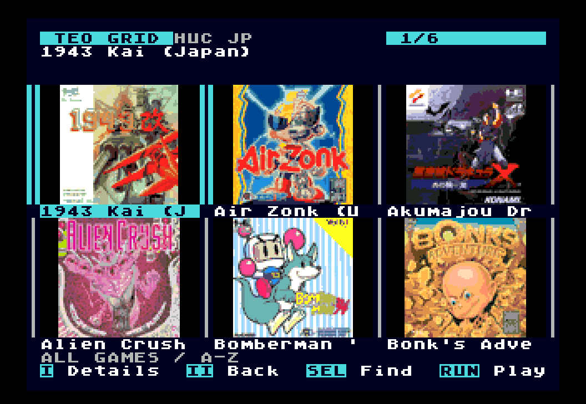

# TeoPCE user guide

[Project home](../README.md) · [Visual tour](TOUR.md)

**Guides:** English · [Deutsch](USER-GUIDE-DE.md) · [Français](USER-GUIDE-FR.md) · [Español](USER-GUIDE-ES.md) · [Italiano](USER-GUIDE-IT.md) · [Українська](USER-GUIDE-UK.md)

The application interface is currently in English. These are translations of the instructions; button names match the application.

For **Catalog Manager 0.2.0-rc6** and **TeoPCE 0.9.15**. Build your own catalog from your own games: no author's collection, AI subscription or API key is required.



*Console UI preview in an emulator; desktop sample collection. [Screenshot provenance](SCREENSHOTS.md).*

## Before you begin

Use a **PC Engine / CoreGrafx + Turbo EverDrive Pro**, with an SD that already works in the native EverDrive menu and your own working CD BIOS for CD games. Follow Krikzz's cartridge/menu/firmware instructions; TeoPCE does not install or update firmware.

Back up the SD, especially `edturbo` saves and existing `00TEOPCE/user` state. The manager's automatic backup covers **TeoPCE.pce and 00TEOPCE**, not the whole card. Keep the working filesystem: TeoPCE installation does not require reformatting.

Turn off the console before removing the card. Use a computer card reader; cartridge USB debugging is not needed.

## Download and open

Get your platform ZIP from the [RC6 release](https://github.com/marvelfamily/TeoPCE/releases/tag/v0.2.0-rc6) and extract it completely. GitHub's automatic source archive is for development, not a standalone app.

Already installed RC4? Back up your card, then replace only `TeoPCE.pce` at the SD root with the [release ROM](https://github.com/marvelfamily/TeoPCE/releases/download/v0.2.0-rc6/TeoPCE.pce). Keep `00TEOPCE`, your games and any recovery journal. If `edturbo/gamedata` is missing, create the empty folder. Safely eject and start TeoPCE. Use RC6 when you next prepare your catalog.

**Mac:** open `TeoPCE Catalog Manager.app`. This download is for Apple Silicon, ad-hoc signed and not notarized. If first launch is blocked, check the download/checksum, then use Apple's **System Settings → Privacy & Security → Open Anyway** if offered. Do not disable Gatekeeper globally. There is no packaged Intel Mac build.

**Windows:** run the extracted `TeoPCE Catalog Manager.exe`, not the copy inside the ZIP view. It is unsigned, so Windows may display an unrecognized-app warning. Review the source/checksum before deciding to run it. RC4 was tested through x64 emulation on Windows 11 ARM64; a later GitHub-hosted Windows build also passed its startup check. A full manual test of the distributed binary on native Intel/AMD Windows remains pending.

Packaged apps need no separate Python. To verify a ZIP, compare its full digest with `SHA256SUMS.txt` from the same release:

```sh
# macOS Terminal
shasum -a 256 TeoPCE-Manager-0.2.0-rc6-macOS-arm64.zip
```

```powershell
# Windows PowerShell
Get-FileHash .\TeoPCE-Manager-0.2.0-rc6-Windows-x64.zip -Algorithm SHA256
```

## Select and prepare

On **Your card**, use **Choose card…** and select the SD **root containing edturbo**, not `edturbo` itself. If a card was detected automatically, check its displayed path.

Click **Prepare collection**. It scans games, hashes content, validates CD track references, matches metadata/cheats and downloads available artwork. Large CD collections take time because all tracks are read. **Activity** shows actual work; leave the card connected.

Preparation creates a separate package on the computer and does not install to the SD. Review **View skipped games & warnings** before installation.

### File layout and formats

Games can remain in their folders. Example, not a required naming scheme:

```text
SD root/
├── edturbo/               native EverDrive data, BIOS and saves
├── HuCard/Example.pce
├── CD/Example/
│   ├── Example.cue
│   ├── Track 01.bin
│   └── Track 02.bin
├── TeoPCE.pce             added by installation
└── 00TEOPCE/              added by installation
    ├── data/              catalog, images, details and attribution
    ├── cheats/            per-game packs
    └── user/              settings and cheat selections
```

- Use `.pce` or `.cue` plus **all** referenced tracks; filenames/case must agree with the CUE.
- ZIP, 7z, CHD, CCD and M3U are not direct inputs. Extract or convert your own media first.
- `MODE1/2048` requires a separately verified raw-sector conversion. The manager reports it, without rewriting the disc.
- Relative game paths must be printable ASCII and shorter than 128 bytes. At most 1,200 catalog candidates are supported.
- SuperGrafx files can be recognized, but are hidden on CoreGrafx; launching them is unsupported in this release.
- Different HuCard revisions sharing a basename can collide in native save storage; reported collisions require deliberate renaming.
- Hidden/underscore-prefixed folders, `edturbo` and `00TEOPCE` are excluded from normal game scanning.

## Review and edit


**Collection** has search, coverage counts and **Missing covers**. `Cmd+F` / `Ctrl+F` focuses search; `Esc` clears it. Select a game to inspect **Game card**, **Edit** or **Cheats**.

In Edit, change title/year/category/description, or **Choose cover…** (PNG/JPG/JPEG). Keep the chosen image available for preparation. Leave an unknown year empty. Use concise English text: the console's limited character set normalizes non-ASCII characters and may drop them.

Click **Save edits → Refresh collection**, review again, then install. An edit alone does not update the card; installation remains disabled while the prepared output is stale.

### What is online?

| Content | Behaviour |
| --- | --- |
| Facts and cheats | Included, pinned snapshots; no account needed |
| Covers/screenshots | Available Libretro Thumbnails images downloaded and cached locally |
| Prose descriptions | Supplied in Edit, or from your owned prepared reference through the CLI |
| Missing images | Clearly marked; add your own cover if desired |
| Work offline | Bundled data, cache and local images only; unavailable art stays missing |

Coverage is not complete for every release. Facts are not invented. Games are read locally and are not uploaded; artwork requests identify the requested title to the serving host. See the activity log and report for source/missing-image information.

## Install and launch

Choose **Install on card**, confirm the prompt and keep the SD connected until **Installed and verified**. The installer checks for changed games/application state, verifies a computer-side backup, stages the new application and verifies the installed set. Detected failures attempt rollback; unplugging or power loss still requires checking the card and backup.

Safely eject in the operating system, insert into the powered-off console, boot the EverDrive menu and launch **TeoPCE.pce** from the root. The ROM and `00TEOPCE` must come from the same prepared generation. Do not mix individual catalog files or use another person's generated catalog.

## Console controls

The footer shows the controls for the current screen.

| Screen | Controls |
| --- | --- |
| Game list | D-pad select/page; **I** details; **SELECT** find/filters; **RUN** play |
| Details | **I** picture; **II** back; **SELECT** game menu; **RUN** play; up/down text; left/right game |
| Game menu | Start, favourite, cheats, file information, return to EverDrive |
| Cheats | **I** toggle/instructions; **SELECT** options; **II** cancel; left/right page; **RUN** save and return |

### Browsing, search and filters

Use **SELECT** from the library to open **FIND AND FILTERS**. Up/down selects an option; left/right changes it. **I** applies settings, or opens the title/genre/letter picker for those rows. **II** cancels. **RUN** clears the filter choices; apply to return to all games.

| Option | What you can choose |
| --- | --- |
| Title prefix | Type the beginning of a title with the on-screen keyboard, up to 12 characters; RUN searches |
| Library | All games, Favorites, Recently opened |
| Category | Original releases, Translations, Homebrew, Museum, Tools / Tests, Unlicensed, or all categories |
| Media | HuCard, CD-ROM, or both |
| Genre | Select from a paged list, such as Action, Adventure, Platform, Puzzle, RPG or Shoot'em Up |
| Letter | A–Z, numerical/symbol-leading titles through `#`, or all letters |
| Region/lang | Japan, USA, English patch, Other, or all |
| Cheats | Any game, or games with selectable cheats |
| View | List with artwork, or six-cover grid |
| Theme | Neon, Ember, Ice, Classic |

Filters combine. For example, choose **Original releases + HuCard + Action**. The ordinary library is ordered A–Z; Recently opened uses history order. There is no year or publisher sort in this version. Filters only change the displayed list; they do not move files. **II** in a filtered library clears the filters.

The selected title is shown above the list/grid, with wrapping for longer names. Details show media, region, genre, year when known, and the available description/developer/publisher information. **I** switches between cover and game screenshot where available; up/down scrolls text and left/right moves between games.

Add or remove a favorite through **Details → SELECT → Add/Remove favorite**. Up to 64 favorites and eight recently opened games are retained. History records opened game cards, not measured playtime. On restart, TeoPCE selects the latest available history entry in the unfiltered library. View and theme preferences are saved too.

Short tags describe the current filter: `FAV` favorites, `OPEN` recent, `B*` titles beginning with B, `R:JP` Japan, `R:US` USA, `L:EN` English patch, and `CH` selectable cheats. The title area also identifies the selected game's medium/region; `*` marks a favorite.

**Details → SELECT** also opens game actions: start, favorites, cheats, file information and return to EverDrive. File information helps identify the selected catalog entry/path when reporting a problem.

## Cheats

The manager matches packs automatically. Its Cheats tab previews groups; activation is **on the console**:

1. Game → **I** details → **SELECT** game menu → **CHEATS**.
2. Highlight a group, press **I** and read any instructions.
3. **RUN** saves the selection and returns. Start the game.
4. **SELECT → All cheats off** disables and saves every group for this game immediately. No extra RUN is needed.

Saved selections persist; the menu indicates active codes. **II** cancels unsaved selection changes.

### Matching, limits and HELD

The included library has **1,177 complete groups for 347 exact releases**. HuCard matching uses the complete file hash. CD matching includes exact CUE bytes and all referenced tracks, including audio. Different revisions, translations or reauthored CUEs may not match. Do not rename a pack to force compatibility.

**53 CD bindings also require the recorded relative path**, because compiled startup policies depend on it. The manager displays that path when it differs. Moving an installed game can affect saved state: use a backed-up fresh setup or a deliberate migration.

Some combinations have incompatible CD startup protections and are blocked. The cartridge also has a 16-slot budget; a group may consume multiple slots and is kept whole. Reduce the selection when required.

**HELD means known issues or unsupported data**, not simply “not console-tested.” Hidden by default, these entries can be inspected through **Show held codes**. Eligible policy-held entries offer **Accept risk** with an explanation; malformed/unsupported codes cannot be unlocked. Combination checks still apply. Hiding HELD does not turn active codes off.

Instructions may require a title-screen action, character or mode. A successful boot does not prove every level's effect. For a BIOS error with a code, clear codes, compare native launching and report the exact group/revision.

**Import extra cheats…** accepts version-1 TeoPCE JSON libraries, not arbitrary emulator files. Explicit imports take priority over bundled content matches; existing installed packs/selections retain priority over both during updates. See [CHEAT-LIBRARY.md](CHEAT-LIBRARY.md).

### Saves and IGM

Native HuCard IGM and quick save/load were exercised on the owner's hardware. IGM exits to **Krikzz's menu**; launch TeoPCE again from there.

In the tested CD setup there is **no native IGM or quick save state**. Normal game/BIOS save support is separate. TeoPCE does not add an in-game overlay to toggle CD codes.

## Updates, storage and recovery

After adding games: **Prepare / Refresh collection → review → Install on card**. Existing profiles/selections are preserved when their identity remains valid. Prepare again after playing if application state changed.

Deleting, renaming or replacing installed games is not a transparent migration. If the previous library no longer matches, retain the backup and resolve the migration; do not delete profiles to bypass the check. A fresh card can be prepared independently. Updating TeoPCE does not update EverDrive firmware.

| Under your computer's home folder | Purpose |
| --- | --- |
| `TeoPCE/prepared/` | Prepared generations and `REPORT.json` |
| `TeoPCE/metadata/` | Editor overrides, associated with the card's mounted path |
| `TeoPCE/backups/installation-…/` | Previous ROM/data; `RESULT.json` after successful installation |
| `.cache/teopce-library/` | Download cache |

Keep overrides/backups you need. A new mount path or Windows drive letter can affect override lookup. Old prepared outputs/cache may be removed with the manager closed; removing cache requires new downloads.

To restore: close the manager, copy the current `TeoPCE.pce` and `00TEOPCE` elsewhere, then **replace both** with the pair from one backup. Do not merge generations. Leave games and `edturbo` alone. A first-install backup may have neither application item and cannot restore a previous version that never existed. Safely eject after copying.

## Troubleshooting

| Symptom | Next step |
| --- | --- |
| Card not found | Choose its root manually; confirm it is mounted and contains `edturbo` |
| Games skipped | Read report; check format, CUE references, ASCII paths, folder exclusions and MODE1/2048 |
| Fails in native menu too | Diagnose image/BIOS/card; TeoPCE does not repair media |
| Only TeoPCE launch fails | Record title/path, console/firmware, exact error and all-off cheat state |
| No compatible codes | Exact content or required path did not match; normal launch remains available |
| Install disabled | Save edits and refresh; preparation must finish for the selected card |
| Card/app changed | Prepare again; do not install an old generation over newer state |
| Missing year/art | Try online preparation or supply your own; unknown year can stay empty |
| Interrupted install | Keep backups and staging files, check the card; never delete a lock while an installer runs |

Use the [issue form](https://github.com/marvelfamily/TeoPCE/issues/new/choose) with versions, steps, error text and native-launch comparison. Redact personal absolute paths. Do not attach games, BIOS, saves or card dumps.

RC6's remaining manual/platform/hardware checks are in [RELEASE-STATUS.md](../RELEASE-STATUS.md). Attribution and redistribution terms are in [THIRD-PARTY.md](../THIRD-PARTY.md); prepared cards retain metadata/cheat attribution under `00TEOPCE/data`.
